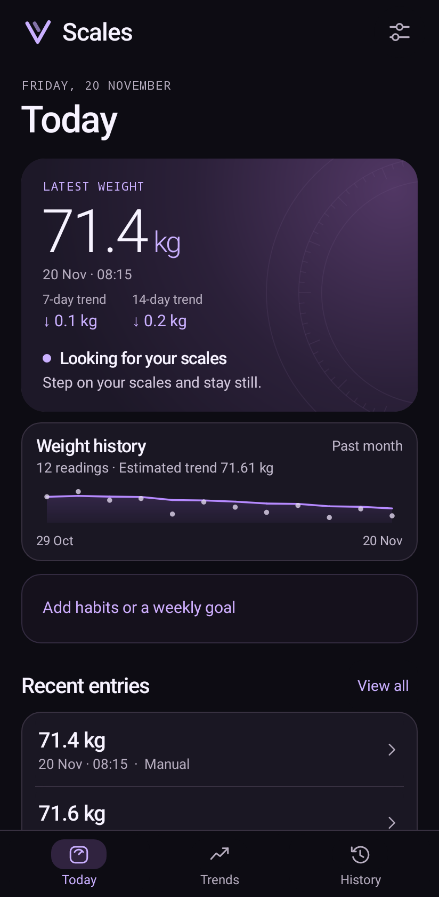
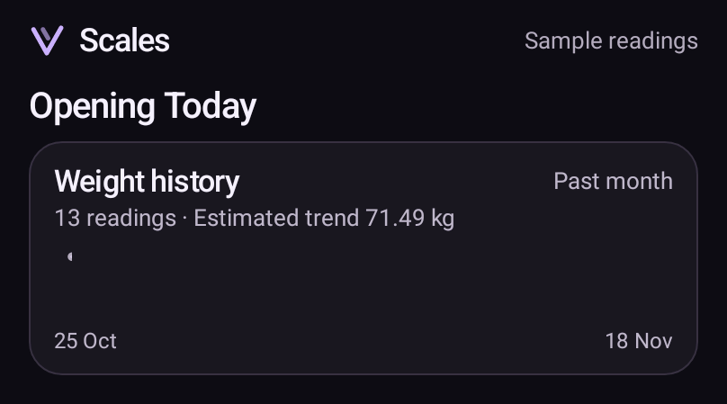

# Scales

Scales is an ad-free, offline Android alternative to apps such as OKOK International for compatible Bluetooth bathroom scales. Open **Today**, step on the scale and see the reading above your weight trend. You can also record weight, waist measurements and notes by hand. Your history starts empty, stays on your phone and can be exported at any time.

[Download Scales 1.2 for Android](https://github.com/smartdevuk/Scales/releases/download/v1.2/Scales-1.2.apk) · [Latest release and checksum](https://github.com/smartdevuk/Scales/releases/latest)



## First weigh-in

1. Install **Scales-1.2.apk** on an Android 6.0 or newer phone. For an update, install over the existing app using a build signed with the same certificate. Save a full backup from Settings before changing phones or signing identities.
2. Open **Today** and allow Bluetooth scanning. Android 12 and later asks for Nearby devices. Older Android versions ask for location while scanning. Leave Bluetooth on.
3. Let the scale go to sleep. Open **Today** before stepping on, wake the scale, and choose it when prompted. Scales remembers your selection.
4. Compare the first result with the scale display and confirm it. Later readings from a fresh, unambiguous weighing can save automatically. Check **History** for the new entry. Long-press the launcher icon for **Weigh now**.

Use **Settings → Choose scales again** when replacing a device. For an unfamiliar model, **Scale diagnostics** can inspect its advertisements or services and save a local capture. Bluetooth support depends on the protocol and hardware revision. See the [compatibility and protocol guide](PROTOCOL.md).

With a phone connected to an authorised ADB session, install or update from Windows or Linux with `adb install -r Scales-1.2.apk`.

## Follow your progress



- **Today** shows your latest saved weight and how its smoothed trend has changed over one and two weeks. Each comparison appears when your history covers that date. If you missed the date, Scales estimates the trend between surrounding readings up to seven days apart. Optional habits let you record resistance training, protein with a meal or a custom activity. A weekly weighing goal counts distinct days.
- **Trends** shows individual observations and a smoothed line for weight or waist. Each local day's median enters an exponential moving average with a seven-day half-life. Tap an observation to inspect it.
- **History** keeps each weigh-in, including two readings at the same weight. Edit an entry, add a note or undo a deletion. A waist measurement can stand on its own.
- **Settings** offers kg, lb, and stones and pounds, optional height for calculated BMI, and tracking, maintenance, gain or loss goals. Reminders have a time and a pause control. They skip days already weighed and weeks when the weighing goal is met.

Consumer scales vary in the measurements they transmit. Scales records weight directly from a supported packet. Where a supported format explicitly identifies a valid impedance reading, the app can retain its value in ohms. Body-fat, muscle and water percentages require separate validation. Waist and weight trends are available independently of those estimates.

## Your data

History and preferences use app-private SQLite storage. The app declares no internet permission. Automatic cloud backup is disabled. **Settings → Import, export and backup** lets you choose a destination for a portable CSV or full JSON backup. Imports show a preview before committing changes. Files contain readable personal information. [Data formats and restore behaviour](DATA.md)

On Android 14 and later, **Send weights to Health Connect** is a separate, user-initiated action. It requests weight-write access, sends eligible locally recorded weights and reconciles edits and deletions on the next export. [Health Connect documentation](https://developer.android.com/health-and-fitness/health-connect/write-data)

## Build

Use JDK 17, Android SDK platform 34 and Android Build Tools 34.0.0. The project uses native Android views, platform Bluetooth APIs and SQLite. Open the repository in Android Studio, or build a development APK from its root.

```sh
./gradlew :app:assembleDebug
```

Windows PowerShell also supports a standalone build and tests.

```powershell
.\build.ps1
.\test.ps1
.\tests\run-data-tests.ps1
```

The standalone build writes `dist/Scales-1.2.apk` and requires an external signing key. Keep your private key outside the repository. Android requires matching application and signing identities for in-place updates. The package remains `uk.co.violetscale.probe` for compatibility with earlier installations. [Build and signing instructions](BUILDING.md) · [Android app signing](https://developer.android.com/studio/publish/app-signing)

## Phone acceptance check

Compare the display on the scale with the first saved reading. Let the scale sleep and weigh again at the same weight. Two intended weigh-ins should produce two entries, while repeated packets within one weigh-in should produce one. Restart the app to check persistence. Also try opening midway through a reading, declining Bluetooth access, turning Bluetooth off and on, and weighing offline with Bluetooth enabled.

[Release notes](docs/RELEASE-1.2.md) · [Screen previews](docs/screenshots/README.md) · [Validation](VALIDATION.md) · [Research](RESEARCH.md) · [Third-party notices](THIRD-PARTY-NOTICES.md)
